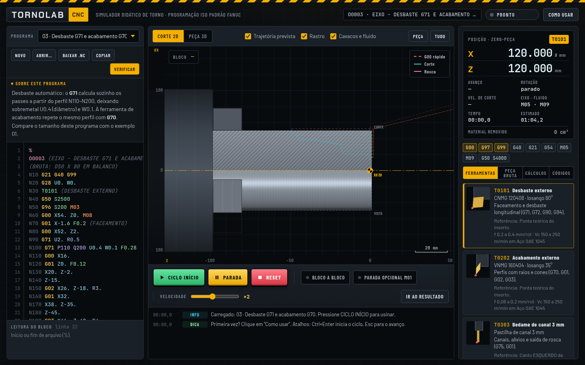
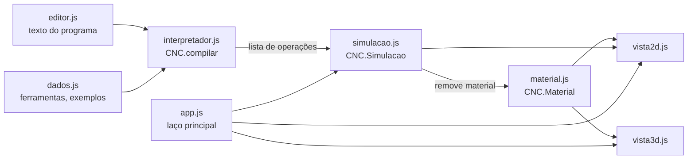

# TornoLab CNC

Simulador didático de torno CNC para o curso técnico em Mecânica. O aluno escreve o programa em código G (padrão ISO/Fanuc), executa e acompanha a usinagem em corte 2D e em 3D. Quando erra, a máquina para com um alarme que explica o problema e indica a linha.

Roda direto no navegador. É HTML, CSS e JavaScript puros: não tem instalação, dependências nem etapa de build.



## Sumário

- [Funcionalidades](#funcionalidades)
- [Como executar](#como-executar)
- [Mudar o projeto de lugar](#mudar-o-projeto-de-lugar)
- [Publicar no GitHub](#publicar-no-github)
- [Estrutura de arquivos](#estrutura-de-arquivos)
- [Arquitetura](#arquitetura)
- [Convenções da máquina simulada](#convenções-da-máquina-simulada)
- [Códigos suportados](#códigos-suportados)
- [Ferramentas da torre](#ferramentas-da-torre)
- [Alarmes](#alarmes)
- [Como estender](#como-estender)
- [Como testar depois de alterar](#como-testar-depois-de-alterar)
- [Limitações conhecidas](#limitações-conhecidas)
- [Dados salvos e privacidade](#dados-salvos-e-privacidade)
- [Licença](#licença)

## Funcionalidades

- **Editor de código G** com realce de sintaxe, numeração de linhas e destaque da linha em execução.
- **Leitura do bloco:** explica cada palavra da linha onde está o cursor. Exemplo: `X46.` vira "diâmetro Ø46 mm (absoluto)".
- **Interpretador Fanuc de torno (sistema A)** com movimentos, arcos, ciclos fixos e funções M.
- **Remoção de material** numa grade de células do meio-corte, usando o formato real de cada ferramenta.
- **Vista 2D:**
  - metade de cima em corte hachurado e metade de baixo em vista sombreada;
  - placa com castanhas girando conforme a rotação;
  - trajetória prevista, rastro executado, cavacos e fluido de corte;
  - zoom com a roda do mouse, arrastar para mover, duplo clique para enquadrar a peça.
- **Peça 3D:** o perfil usinado é revolucionado e pode ser girado com o mouse.
- **Alarmes didáticos:** G00 dentro do material, colisão com a placa, colisão do suporte, corte sem rotação, arco impossível, falta de F e outros.
- **Comandos da máquina:**
  - Ciclo início, Parada de avanço e Reset;
  - Bloco a bloco e Parada opcional M01;
  - velocidade da simulação de ×0,1 a ×100;
  - "Ir ao resultado", que executa tudo sem animação.
- **Painel de estado:**
  - posição X/Z, avanço, rotação e velocidade de corte;
  - tempo de ciclo real e estimado, volume removido;
  - códigos modais ativos.
- **Abas de apoio:**
  - tabela de ferramentas;
  - peça bruta configurável, com 5 materiais;
  - calculadoras de rotação, avanço e tempo, rugosidade e rosca métrica;
  - referência de códigos com botão "Inserir".
- **9 programas-exemplo,** incluindo um exercício com 4 erros escondidos e gabarito.
- **Salvamento automático** do programa no navegador.
- **Funciona em computador, tablet e celular.**

## Como executar

### Abrir o arquivo direto

Dê dois cliques em `index.html`. Funciona nos navegadores atuais: Chrome, Edge, Firefox e Safari. Os scripts são clássicos (não usam módulos ES), por isso também funcionam pelo endereço `file://`.

### Servidor local

O servidor só é necessário para acessar o simulador de outros aparelhos.

```bash
cd caminho/para/simulador-torno-cnc
python3 -m http.server 8765
```

Depois abra http://localhost:8765. Qualquer servidor de arquivos estáticos serve. Com Node instalado, por exemplo: `npx serve -l 8765`.

### Pelo celular, na mesma rede Wi-Fi

1. Suba o servidor local, como mostrado acima.
2. Descubra o IP do computador:
   - Linux: `hostname -I`, primeiro número que começa com 192.168;
   - Windows: `ipconfig`, linha "Endereço IPv4";
   - macOS: `ipconfig getifaddr en0`.
3. No celular, abra `http://SEU_IP:8765`. Exemplo: `http://192.168.29.162:8765`.

Se não abrir, o firewall pode estar bloqueando a porta. No Ubuntu, libere com:

```bash
sudo ufw allow 8765/tcp
```

### GitHub Pages: link público para os alunos

Depois de publicar no GitHub (seção abaixo), faça no repositório:

1. Abra **Settings → Pages**.
2. Em **Build and deployment**, escolha **Source: Deploy from a branch**.
3. Escolha **Branch: main**, pasta **/ (root)**, e clique em **Save**.

Em um ou dois minutos o simulador fica disponível em `https://SEU_USUARIO.github.io/NOME_DO_REPOSITORIO/`. O GitHub Pages gratuito exige repositório público.

## Mudar o projeto de lugar

O projeto é autocontido. Todos os caminhos são relativos (`css/…`, `js/…`, `docs/…`), então basta mover ou copiar a pasta `simulador-torno-cnc` inteira.

- **Mantenha a estrutura de pastas** e a ordem das tags `<script>` no `index.html`. Cada arquivo depende dos anteriores.
- **O programa salvo no navegador fica preso ao endereço da página.** Ao abrir de outro caminho `file://`, de outro servidor ou de outra porta, o simulador começa do zero, no exemplo 03. Para levar um programa, use **Baixar .nc** ou **Copiar** antes de mover e **Abrir…** depois.
- **Arquivos fora desta pasta não fazem parte do projeto.** Isso inclui o `.claude/launch.json` da pasta de cima, usado só na pré-visualização do Claude Code e com caminho absoluto, e os PDFs das aulas.
- **As fontes vêm do Google Fonts.** Sem internet, o navegador usa as fontes do sistema e o simulador continua funcionando.

## Publicar no GitHub

### Pelo site do GitHub e o terminal

1. Crie um repositório vazio em https://github.com/new. Não marque README, `.gitignore` nem licença, para não gerar conflito no primeiro envio.
2. No terminal, dentro da pasta do projeto, rode:

```bash
cd caminho/para/simulador-torno-cnc
git init -b main
git add .
git commit -m "TornoLab CNC: simulador didático de torno"
git remote add origin https://github.com/SEU_USUARIO/tornolab-cnc.git
git push -u origin main
```

O GitHub não aceita a senha da conta no `git push`. Use uma destas opções:

- um token de acesso pessoal no lugar da senha, criado em **Settings → Developer settings → Personal access tokens**;
- uma chave SSH, com a URL `git@github.com:SEU_USUARIO/tornolab-cnc.git` no `git remote add`.

### Com a GitHub CLI

Se tiver a [GitHub CLI](https://cli.github.com/) instalada, rode depois do `git commit`:

```bash
gh auth login
gh repo create tornolab-cnc --public --source=. --remote=origin --push
```

### Próximos commits

```bash
git add .
git commit -m "descreva a mudança"
git push
```

## Estrutura de arquivos

```
simulador-torno-cnc/
├── index.html          estrutura da página e ordem de carregamento dos scripts
├── README.md           esta documentação
├── css/
│   └── estilo.css      visual (tema escuro de painel de comando) e layout responsivo
├── docs/
│   └── captura.png     imagem usada no README
└── js/
    ├── dados.js           máquina, placa, materiais, ferramentas, exemplos e dicionário de códigos
    ├── interpretador.js   leitura do código G, ciclos fixos, validações e decodificador didático
    ├── material.js        peça bruta em grade de células, remoção de material e geometria
    ├── simulacao.js       execução no tempo, colisões e alarmes
    ├── vista2d.js         desenho da vista em corte, placa, trajetórias e partículas
    ├── vista3d.js         peça 3D (revolução do perfil, sem WebGL)
    ├── editor.js          editor com realce de sintaxe
    └── app.js             liga tudo: botões, console, painel de estado, abas e calculadoras
```

## Arquitetura

Todo o código fica no objeto global `window.CNC`. Os scripts são carregados em ordem pelo `index.html`, sem módulos, para funcionar também via `file://`.



1. **Compilação.** `CNC.compilar(texto, cfg)` lê o programa inteiro de uma vez e devolve `{ ops, erros, avisos, tempo, limites, modalLinha }`.
   - Os ciclos (G70–G76, G90/G92/G94) são expandidos em movimentos simples.
   - No primeiro erro de programa, a leitura para e entra uma operação `alarme`. A simulação roda até ali e alarma na linha certa, como numa máquina real.
2. **Operações.** Cada item de `ops` tem um tipo e uma cópia `st` do estado modal: avanço, rotação, G96/G97, G98/G99, ferramenta, eixo e fluido. Os tipos são:
   - `mov`, com `modo` igual a `rapido`, `avanco` ou `rosca`;
   - `estado`, `nota`, `ferr` e `pausa`;
   - `parada`, `fim` e `alarme`.
3. **Simulação.** `Simulacao.avancar(dt)` consome as operações em tempo simulado. A velocidade sai de F, S, G96/G97 e G98/G99. A cada passo, verifica nesta ordem:
   - colisão com a placa (teste de eixos separadores);
   - colisão em G00;
   - colisão do suporte;
   - remoção de material.

   No roscamento, o perfil da ferramenta é carimbado a cada passo da rosca. Assim os filetes aparecem no corte.
4. **Material.** A peça é uma grade de células no plano (z, r), com resolução automática entre 0,05 e 0,5 mm e no máximo cerca de 650 mil células.
   - A área varrida é a envoltória convexa do polígono da ferramenta no início e no fim do passo. Para retas, isso é exato.
   - O módulo gera duas imagens: a máscara do corte e a vista sombreada.
   - Também detecta quando a peça se separa da barra depois do sangramento.
5. **Vistas.**
   - `Vista2D` desenha a cena em canvas 2D.
   - `Vista3D` simplifica o perfil (Douglas-Peucker), revoluciona em 72 segmentos e desenha pelo algoritmo do pintor.

Convenção geométrica interna: plano (z, r), com r = X ÷ 2. Z é positivo em direção à contraponta e r é positivo para cima.

## Convenções da máquina simulada

- **Torre traseira:** X para cima, Z para a direita. G02 é horário na tela e G03 é anti-horário.
- **Coordenadas:** X é sempre diâmetro e U/W são incrementais. O zero-peça (X0 Z0) fica no centro da face acabada.
- **Fanuc sistema A:** G90 é o ciclo de torneamento. Absoluto e incremental são escolhidos pelos endereços (X/Z ou U/W).
- **G74, G75 e G76:** P e Q sem ponto decimal são lidos em micrômetros. Q8000 = 8 mm.
- **X e Z sem ponto decimal** são lidos em milímetros. Em alguns comandos reais, X10 vale 0,010 mm: oriente os alunos a sempre escrever o ponto (`X10.`).
- **Ponto de referência (G28):** Z120. X fica no maior valor entre 120 e (Ø da bruta + 60), arredondado para cima a cada 10 mm.
- **Curso:** X de −40 até a referência + 80; Z até a referência + 80.
- **Máquina** (constantes em `CNC.MAQUINA`): 4000 rpm, avanço rápido de 12 m/min e troca de ferramenta em 1,2 s.
- **Placa:** castanhas de 18 mm de comprimento, começando em Z = −balanço. Constantes em `CNC.PLACA`.

## Códigos suportados

| Grupo | Códigos |
|---|---|
| Movimento | G00, G01, G02, G03 (R ou I/K), G04, G28, G32 |
| Ciclos fixos | G70, G71, G72, G74, G75, G76, G90, G92, G94 |
| Configuração | G18, G20 (aceito, valores em mm), G21, G40, G41 e G42 (aceitos, não simulados), G50 S, G54–G59, G96, G97, G98, G99 |
| Funções M | M00, M01, M02, M03, M04, M05, M08, M09, M30; M06 gera só um aviso |
| Endereços | N, O, X, Z, U, W, R, I, K, F, S, T (formato T0101), P, Q; comentários entre parênteses ou após `;` |

Não suportados (geram alarme explicando): G73, M98/M99, G50 com X/Z, G53, G65, G12.1/G112 e G80–G89.

## Ferramentas da torre

| T | Ferramenta | Ponto de referência |
|---|---|---|
| T01 | Desbaste externo, CNMG 80° | ponta teórica do inserto |
| T02 | Acabamento externo, VNMG 35° | ponta teórica do inserto |
| T03 | Bedame de canal 3 mm | canto **esquerdo** da lâmina, lado da placa |
| T04 | Rosca externa 60° | ponta do perfil |
| T05 | Broca helicoidal Ø18 (HSS) | ponta, no centro (X0) |
| T06 | Barra de mandrilar (interna) | ponta teórica do inserto |
| T07 | Bedame de corte 3 mm | canto **esquerdo** da lâmina |
| T08 | Broca de centro A2,5 | ponta, no centro (X0) |

## Alarmes

| Código | Quando acontece |
|---|---|
| PS | Erro de programa encontrado na leitura: sintaxe, arco impossível, falta de F, bloco P/Q inexistente, código não suportado, sobrecurso e outros |
| AL 1010 | O G00 entrou no material |
| AL 1020 | A ferramenta ou o suporte atingiria a placa |
| AL 1030 | O suporte da ferramenta bateu na peça durante o corte |
| AL 2010 | Avanço em G99 ou roscamento com o eixo-árvore parado ou S0 |
| AL 2011 | Velocidade de avanço nula |
| AL 2012 | A ferramenta encostou no material sem rotação (G98) |

Uma colisão só é acusada quando a sobreposição passa de 0,3 mm². O valor fica em `LIM_AREA`, no `simulacao.js`, e evita falsos alarmes quando a ferramenta só desliza na superfície.

Além dos alarmes, o console mostra **avisos** e **dicas**. Alguns exemplos:

- velocidade de corte fora da faixa do material;
- avanço alto demais para a ferramenta;
- troca de ferramenta perto da peça;
- G96 sem G50;
- programa sem M30.

## Como estender

### Novo programa-exemplo

Acrescente um objeto em `CNC.EXEMPLOS`, no `js/dados.js`. Ele aparece sozinho na lista.

```js
{
  id: 'ex10',
  titulo: '10 · Meu exemplo',
  bruta: { d: 40, l: 60, face: 1, furo: 0, mat: 'aco1045' },   // mm; mat é uma chave de CNC.MATERIAIS
  objetivo: 'Texto em HTML curto explicando o que o exemplo ensina.',
  codigo: `%
O0010 (MEU EXEMPLO)
...
M30
%`
}
```

### Nova ferramenta

Acrescente uma entrada em `CNC.FERRAMENTAS`, no `js/dados.js`.

- **Coordenadas:** em mm, com a origem no ponto de referência da ferramenta. z cresce para a contraponta e r para cima.
- **`corte`:** lista de polígonos que removem material. Cada polígono precisa ser **convexo**. Um formato não convexo deve ser dividido em partes convexas, como na T08.
- **`corpo`:** suporte ou haste. Não corta, só colide.
- **Outros campos:** `num`, `nome`, `tipo` (`externa`, `interna`, `canal`, `rosca` ou `broca`), `md` (`true` = metal duro), `f` (faixa de avanço), `ref`, `uso`, `cor` e, nas brocas, `diam`.

O interpretador aceita qualquer número que exista em `CNC.FERRAMENTAS`. Para criar uma T09, basta adicionar a chave `9`.

### Novo material

Acrescente uma entrada em `CNC.MATERIAIS` com:

- `nome`;
- `vcMD` e `vcHSS`: faixas de Vc em m/min, para metal duro e aço rápido;
- `cor`: RGB da peça;
- `cavaco`: lista de cores dos cavacos.

### Novo código G ou M

1. Trate o código no `switch` de `executarBloco`, em `js/interpretador.js`. Ciclos ficam em funções próprias, como `cicloG76`.
2. Acrescente o código em `CNC.CODIGOS`, no `js/dados.js`. Ele passa a aparecer na aba Códigos e no decodificador.
3. Se o código der novo significado a algum endereço (P, Q, R…), ajuste os textos em `CNC.decodificar`.

## Como testar depois de alterar

O núcleo (`dados`, `interpretador`, `material` e `simulacao`) roda no Node sem navegador. Dentro da pasta do projeto, este comando executa todos os exemplos:

```bash
node -e "
global.window = global;
for (const f of ['dados', 'interpretador', 'material', 'simulacao']) require('./js/' + f + '.js');
const CNC = window.CNC;
for (const ex of CNC.EXEMPLOS) {
  const cfg = { bruta: ex.bruta, home: { x: Math.max(120, Math.ceil((ex.bruta.d + 60) / 10) * 10), z: 120 } };
  const sim = new CNC.Simulacao();
  sim.carregar(CNC.compilar(ex.codigo, cfg), cfg);
  sim.estado = 'rodando';
  while (sim.estado === 'rodando') sim.avancar(5);
  console.log(sim.estado.padEnd(7), ex.titulo);
}"
```

O resultado esperado é `fim` em todos os exemplos e `alarme` só no 07, que tem erros de propósito.

Depois, confira no navegador:

1. Abra o console (F12) e veja que não há erros em vermelho.
2. Rode cada exemplo com **Ir ao resultado**. Cada um deve terminar com "M30: fim de programa", menos o 07.
3. No exemplo 07, os alarmes devem aparecer nesta ordem:
   1. N50: eixo parado;
   2. N120: G00 no material;
   3. N170: raio impossível;
   4. N200: placa.

   Corrigindo conforme o gabarito, o programa termina.
4. Teste o botão **Verificar**, as vistas 2D e 3D e a largura de celular. Na largura de celular, a página não pode ter rolagem lateral.

## Limitações conhecidas

- A compensação do raio da ponta (G41/G42) não é simulada: o desenho mostra a ponta teórica.
- G71 e G72 trabalham só no tipo I, com perfil monotônico, sem bolsões.
- A peça é um sólido de revolução. Por isso não há fresamento, furação radial nem ferramenta acionada.
- Na vista 3D, a rosca aparece como anéis, e não como hélice. Na vista 2D, os filetes aparecem no corte.
- G20 é aceito, mas os valores continuam sendo lidos em milímetros.
- É uma simulação didática e não substitui o manual do comando nem a verificação na máquina real.

## Dados salvos e privacidade

O simulador guarda no `localStorage` do navegador:

- `tornolab.programa`: o texto do programa;
- `tornolab.bruta`: a peça bruta;
- `tornolab.exemplo`: o exemplo carregado;
- `tornolab.vel`: a velocidade da simulação;
- `tornolab.aba`: a última aba aberta.

Nada é enviado para servidores. A única requisição externa carrega as fontes do Google Fonts.

## Licença

Ainda não definida. Antes de tornar o repositório público, escolha uma licença e adicione o arquivo `LICENSE`. Algumas opções:

- **MIT:** uso livre, inclusive em outros projetos;
- **CC BY-SA 4.0:** comum em material didático.

No GitHub, use **Add file → Create new file**, digite `LICENSE` como nome e escolha um modelo.
